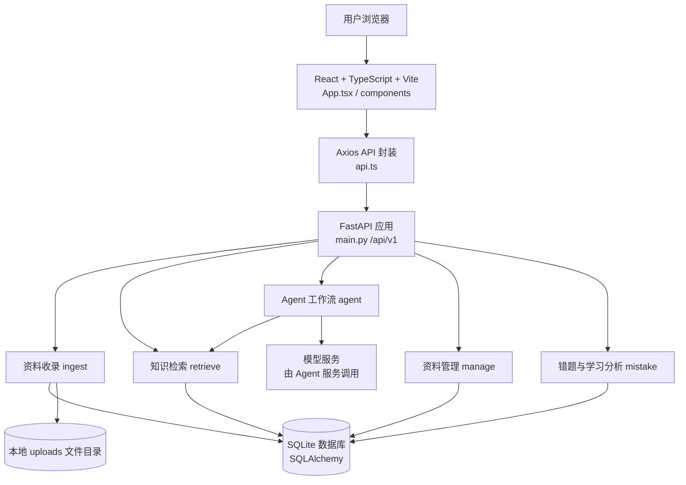
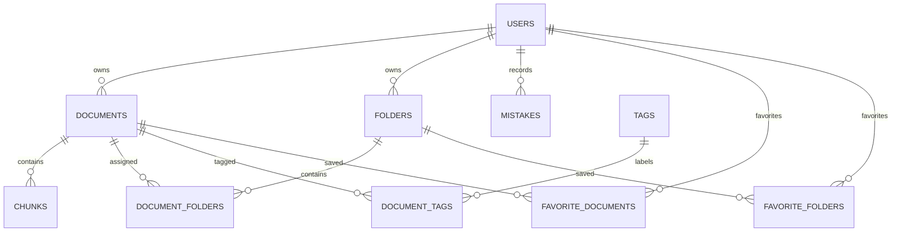
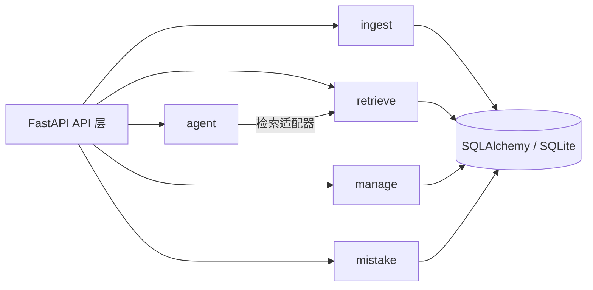
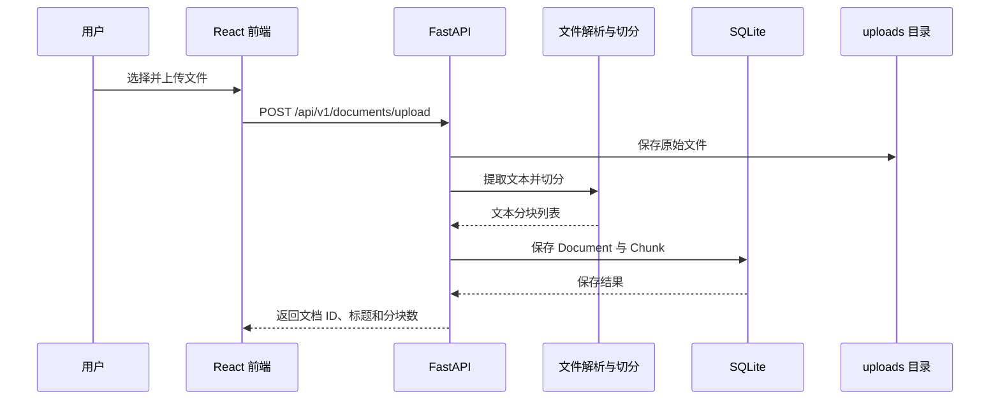
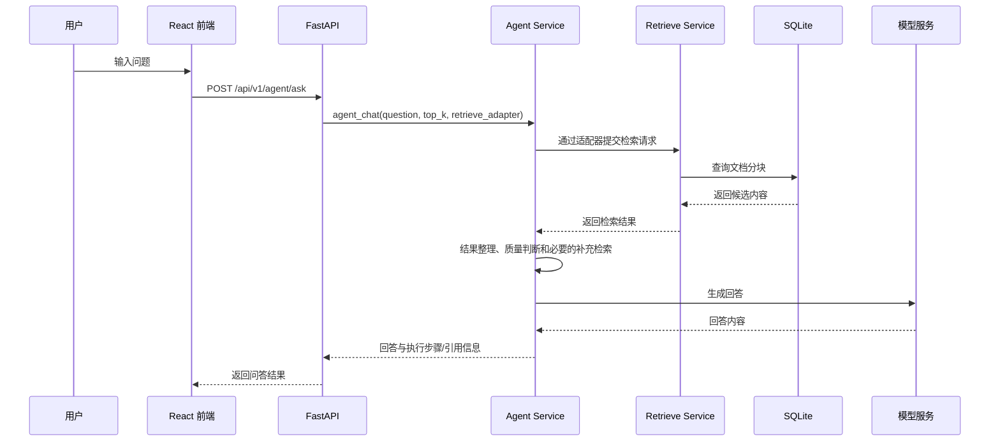
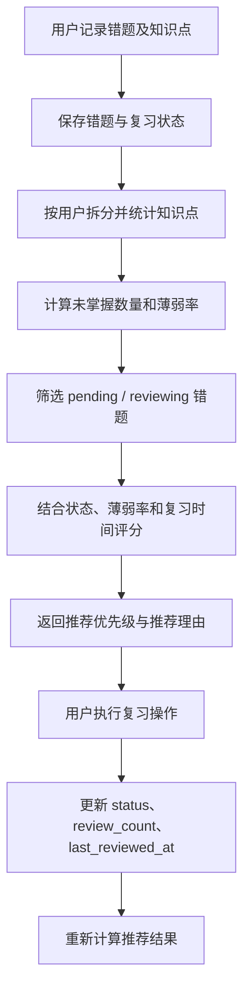

# Personal Knowledge Base — 系统架构与模块设计

> 文档版本：1.0
> 更新日期：2026-11-07
> 文档状态：按当前已实现代码整理
> 适用仓库：`epoch-fresh-2026/personal-knowledge-base`

## 1. 项目概述

Personal Knowledge Base 是一个面向个人学习与知识管理的 Web 系统。系统将个人资料收录、知识检索、AI 辅助问答、错题管理、薄弱知识点分析和个性化复习建议整合在同一应用中，形成从知识收集到学习反馈的基本闭环。

系统当前包含两类相互配合的业务：

1. **个人知识管理**：上传文件或收录网页内容，对文档进行分类、标签管理、收藏与公开分享，并通过检索和 Agent 工作流查询个人资料。
2. **学习管理**：记录错题和关联知识点，跟踪复习状态与次数，统计知识点掌握情况，并基于规则生成复习建议。

本文档描述当前代码中已经实现的结构。尚未实现的能力会在“当前边界与后续改进”中单独说明，不将规划功能描述为现有能力。

## 2. 技术架构

| 层次 | 当前技术/实现 | 主要职责 |
|---|---|---|
| 前端 | React、TypeScript、Vite | 页面展示、交互、用户切换、调用后端 API |
| 前端请求层 | Axios，集中封装于 `frontend/src/api.ts` | 统一配置 API 地址和请求方法 |
| 后端 Web 层 | Python、FastAPI | HTTP 路由、参数校验、依赖注入、响应返回 |
| 业务层 | Python Service | 文档处理、检索、Agent 工作流、标签/文件夹管理、错题分析与推荐 |
| 数据访问层 | SQLAlchemy | ORM 模型和数据库读写 |
| 数据库 | SQLite（由 `DATABASE_URL` 配置） | 保存用户、文档、分块、文件夹、标签、收藏和错题等业务数据 |
| 文件存储 | 本地 `backend/uploads/` | 保存上传的原始文件 |
| 文档解析 | pypdf、python-docx、BeautifulSoup、httpx | 解析 PDF/Word 文本、抓取网页文本 |

### 2.1 系统总体架构



说明：前端通过 FastAPI 的 `/api/v1` 接口访问业务能力。后端通过 SQLAlchemy 访问 SQLite；上传文件本体保存在本地目录，文档元数据和文本分块保存在数据库。Agent 工作流通过检索适配器调用检索服务，并由 Agent 服务组织问答步骤。

## 3. 项目目录结构

以下目录树省略 `__pycache__`、`.pytest_cache`、`.venv`、构建产物和其他运行时文件，只保留源代码及主要运行目录。

```text
personal-knowledge-base/
├─ backend/
│  ├─ main.py                     # FastAPI 应用入口
│  ├─ api/
│  │  └─ router.py                # 统一 API 路由及业务接口注册
│  ├─ shared/
│  │  ├─ db.py                    # SQLAlchemy Engine、Session、Base、get_db、init_db
│  │  └─ config.py                # 数据库等公共配置
│  ├─ modules/
│  │  ├─ ingest/                  # 文档收录与解析
│  │  │  ├─ controller/
│  │  │  ├─ domain/               # 文档、分块等核心模型
│  │  │  ├─ repository/           # 文档持久化
│  │  │  └─ service/              # 文本切分等处理逻辑
│  │  ├─ retrieve/                # 知识检索
│  │  │  ├─ controller/
│  │  │  ├─ domain/
│  │  │  ├─ repository/
│  │  │  └─ service/              # search 服务
│  │  ├─ agent/                   # Agent 智能问答工作流
│  │  │  ├─ controller/
│  │  │  ├─ service/              # agent_service.py
│  │  │  └─ tools/                # retrieve_tool.py、qa_tool.py
│  │  ├─ manage/                  # 文档、文件夹、标签、收藏和公开管理
│  │  │  ├─ controller/
│  │  │  ├─ domain/
│  │  │  ├─ repository/
│  │  │  └─ service/              # folder/tag/document 服务
│  │  └─ mistake/                 # 错题与学习管理
│  │     ├─ controller/           # router.py
│  │     └─ service/              # 知识点统计、复习推荐
│  ├─ migrations/                 # 数据库迁移脚本
│  ├─ tests/                      # 自动化测试
│  ├─ uploads/                    # 上传文件存储目录
│  ├─ requirements.txt
│  └─ .env.example
├─ frontend/
│  ├─ src/
│  │  ├─ main.tsx                 # React 启动入口
│  │  ├─ App.tsx                  # 主布局、导航和页面切换
│  │  ├─ api.ts                   # Axios 实例与 API 方法
│  │  ├─ App.css
│  │  ├─ index.css
│  │  ├─ assets/
│  │  └─ components/
│  │     ├─ ChatArea.tsx
│  │     ├─ UploadPanel.tsx
│  │     ├─ FolderView.tsx
│  │     ├─ FavoriteView.tsx
│  │     ├─ MistakeView.tsx
│  │     ├─ KnowledgePointView.tsx
│  │     ├─ ReviewRecommendationView.tsx
│  │     ├─ SquareView.tsx
│  │     └─ UserProfileView.tsx
│  └─ package.json
└─ README.md
```

实际目录中存在部分预留的 `controller`、`domain`、`repository` 子目录；各模块的分层完整度并不完全相同。当前统一 API 路由主要集中在 `backend/api/router.py`，错题模块通过独立的 `backend/modules/mistake/controller/router.py` 注册。

## 4. 后端模块职责

### 4.1 ingest：资料收录

**职责**：接收文件或网页地址，提取可处理的文本，将文档元数据和文本分块保存。

主要流程：

1. 接收上传文件或 URL。
2. 对 PDF、DOCX、TXT、Markdown 和代码文本等格式提取文本；网页收录通过 HTTP 请求获取页面并使用 BeautifulSoup 提取文本。
3. 调用 `split_markdown` 对文本进行分块。
4. 创建 `Document` 和关联的 `Chunk` 记录。
5. 通过 repository 保存数据库记录；上传文件本体写入 `uploads/`。

当前上传路由还能够识别常见图片和视频文件扩展名并保存文件，但代码中对应分支目前写入的是文件标记文本，并不代表已经实现 OCR 或视频语音识别。

### 4.2 retrieve：知识检索

**职责**：根据用户查询，从已收录的知识内容中检索相关资料。

主要入口：`GET /api/v1/search`。API 层调用 `modules.retrieve.service.search.search(db, q, top_k)`。具体检索策略以 `search.py` 的当前实现为准；本文档不将尚未核实的向量检索能力列为现有功能。

### 4.3 agent：Agent 智能问答

**职责**：组织多步骤问答流程，协调检索工具和答案生成工具。

主要入口：`POST /api/v1/agent/ask`。API 层创建检索适配器，将查询请求交给 `agent_chat`。Agent 服务通过工具层调用检索和问答能力，避免在 Agent 工作流中直接操作数据库。

当前工作流包含查询处理、多路检索结果整理、去重与排序、检索质量判断、必要时进行一次补充检索、执行步骤记录和答案生成等环节。检索由 API 层提供适配器，Agent 不直接持有数据库 Session。

### 4.4 manage：资料管理

**职责**：管理文档元数据、文件夹、标签、公开状态、公共广场和收藏。

主要能力包括：

- 文档列表、过滤、元数据修改和删除。
- 文件夹创建、重命名、删除，以及文档与文件夹之间的关联。
- 标签创建、删除、置顶，以及文档与标签之间的关联。
- 文档/文件夹公开状态切换。
- 公共广场、用户公开资料和收藏管理。

API 路由主要定义在 `backend/api/router.py`，业务逻辑由 `modules.manage.service` 下的服务实现。

### 4.5 mistake：错题与学习管理

**职责**：管理错题、复习状态、知识点统计和个性化复习建议。

包含三类主要能力：

1. **错题管理**：新增、查询、编辑、删除错题，修改复习状态。
2. **薄弱知识点分析**：拆分错题中的知识点字段，按用户统计错题数、复习状态分布、复习次数和薄弱率。当前薄弱率定义为“未掌握错题数 / 关联错题总数”，未掌握包括 `pending` 和 `reviewing`。
3. **个性化复习建议**：筛选当前用户的待复习和复习中错题，根据复习状态、知识点薄弱情况和距上次复习时间计算规则评分，返回优先级及可解释推荐理由。已掌握错题不进入推荐列表。

复习操作复用错题复习接口，更新状态、累计复习次数和最近复习时间。推荐结果当前为动态计算结果，没有单独持久化为复习任务表。

## 5. 前端结构与页面职责

前端使用 `App.tsx` 管理主布局和侧边栏导航，各业务页面由独立 React 组件承担。`api.ts` 创建 Axios 实例并集中封装后端请求。

| 页面组件 | 功能 |
|---|---|
| `ChatArea.tsx` | AI 智能问答 |
| `UploadPanel.tsx` | 文件上传与资料收录 |
| `FolderView.tsx` | 个人资料库和文件夹管理 |
| `FavoriteView.tsx` | 收藏管理 |
| `MistakeView.tsx` | 错题新增、编辑、删除和复习 |
| `KnowledgePointView.tsx` | 薄弱知识点统计和状态分布 |
| `ReviewRecommendationView.tsx` | 推荐任务、评分、理由和复习操作 |
| `SquareView.tsx` | 公共资料浏览 |
| `UserProfileView.tsx` | 用户公开资料页面 |

前端通过 `getCurrentUser()` 读取浏览器 `localStorage` 中的当前演示用户，并在相关请求中传递 `user_id`。当前实现是演示用的用户切换机制，不等同于完整的身份认证和授权系统。

## 6. 核心数据模型

数据库连接由 `backend/shared/db.py` 创建，数据库地址从 `shared.config.DATABASE_URL` 读取。当前开发环境使用 SQLite，默认数据库文件为 `pkb.db`。ORM 基类和 Session 由 SQLAlchemy 管理。

已使用的主要业务表包括：

| 数据表 | 用途 |
|---|---|
| `users` | 用户基本信息 |
| `documents` | 文档元数据、来源、公开状态和所有者 |
| `chunks` | 文档切分后的文本片段 |
| `folders` | 用户文件夹 |
| `document_folders` | 文档与文件夹关联 |
| `tags` | 文档标签 |
| `document_tags` | 文档与标签关联 |
| `favorite_documents` | 用户收藏的文档 |
| `favorite_folders` | 用户收藏的文件夹 |
| `mistakes` | 错题、知识点、复习状态和复习记录 |

主要关系可概括为：



`Mistake` 当前包含题目、正确答案、错误答案、错误原因、`knowledge_points`、`status`、`review_count`、`last_reviewed_at` 和创建/更新时间等字段。复习状态使用 `pending`、`reviewing`、`mastered`。

文档收录时创建文本分块记录。当前上传路由创建 `Chunk` 时将 `embedding` 设置为 `None`；因此数据库中存在 embedding 字段，不代表当前流程已经完成向量生成或向量数据库检索。

## 7. 模块依赖与边界



依赖原则：

- 前端只通过 HTTP API 访问后端，不直接访问数据库。
- API 层负责接收请求、参数校验、依赖注入和调用业务服务。
- Service 层承载业务规则，尽量避免在前端重复实现业务逻辑。
- Repository/ORM 负责数据持久化；数据库 Session 由 `get_db` 依赖提供。
- Agent 通过检索适配器和工具调用检索能力，不直接操作数据库。
- 错题统计和推荐只处理传入 `user_id` 对应的数据。

当前代码处于逐步模块化阶段：部分管理和收录路由仍集中在 `backend/api/router.py`，错题路由则已独立到 mistake controller。后续可以逐步统一路由分层，但不应为了文档上的形式而声称所有模块已经采用完全一致的四层架构。

## 8. 核心业务数据流

### 8.1 文件收录流程



### 8.2 Agent 问答流程



### 8.3 错题分析与复习流程



## 9. 主要 API 入口

统一 API 前缀为 `/api/v1`。当前入口包括：

| 路径 | 方法 | 作用 |
|---|---|---|
| `/health` | GET | 服务健康检查（不带 `/api/v1` 前缀） |
| `/api/v1/documents/upload` | POST | 上传文件并收录 |
| `/api/v1/documents/url` | POST | 收录网页 URL |
| `/api/v1/search` | GET | 知识检索 |
| `/api/v1/agent/ask` | POST | Agent 智能问答 |
| `/api/v1/tags` | GET/POST | 标签查询与创建 |
| `/api/v1/folders` | GET/POST | 文件夹查询与创建 |
| `/api/v1/mistakes` | GET/POST | 错题查询与新增 |
| `/api/v1/mistakes/{mistake_id}` | PUT/DELETE | 编辑与删除错题 |
| `/api/v1/mistakes/{mistake_id}/review` | POST | 完成一次复习并更新记录 |
| `/api/v1/mistakes/knowledge-points` | GET | 薄弱知识点统计 |
| `/api/v1/mistakes/recommendations` | GET | 个性化复习建议 |

其他文档、文件夹、收藏和公共广场接口见 `backend/api/router.py` 与 `backend/modules/mistake/controller/router.py`。

## 10. 本地运行方式

以下为项目当前采用的开发方式，具体端口以启动命令输出为准。

### 后端

```cmd
cd backend
.venv\Scripts\activate
python -m uvicorn main:app --reload
```

后端默认开发地址：`http://127.0.0.1:8000`。Swagger 文档：`http://127.0.0.1:8000/docs`。

### 前端

```cmd
cd frontend
npm install
npm run dev
```

Vite 会在终端中显示前端开发地址，通常为 `http://localhost:5173`。

### 测试与构建

在项目根目录运行后端测试：

```cmd
backend\.venv\Scripts\python.exe -m pytest -q backend
```

在 `frontend` 目录运行前端生产构建：

```cmd
npm run build
```

## 11. 当前实现边界与后续改进

为避免架构说明夸大现有能力，当前需要明确以下边界：

1. **认证与授权**：前端当前通过 `localStorage` 保存演示用户并在请求中传递 `user_id`。这适合本地演示和多用户数据隔离测试，但不等同于生产级登录、身份认证和服务端授权。
2. **向量检索**：当前上传流程创建分块记录时将 `embedding` 设为 `None`。向量生成、向量数据库和 pgvector 不应描述为已经落地，除非后续实现并完成验证。
3. **图片与视频理解**：上传接口能够保存常见图片/视频文件，但当前代码路径并未实现完整 OCR、图像理解或视频 ASR。
4. **复习任务持久化**：智能复习建议通过现有错题和复习记录动态计算，没有独立的复习任务持久化模型。
5. **跨模块路由分层**：当前 `api/router.py` 仍包含不少管理和收录接口，错题模块使用独立 Router。后续可以继续整理统一的 Controller/Service/Repository 边界。
6. **生产部署配置**：当前 `main.py` 的 CORS 配置允许所有来源，属于开发阶段配置。生产部署前应限制允许的前端域名，并完善密钥管理、认证授权、日志、备份和部署配置。
7. **学习数据统计**：可在现有错题与复习记录基础上，进一步增加学习趋势、复习频次和知识点掌握变化的可视化。

## 12. 总结

系统当前已经形成“资料收录 → 知识检索 → Agent 问答 → 错题记录 → 薄弱知识点分析 → 个性化复习建议”的主要业务闭环。后续建设应优先完善架构文档、测试和部署说明，并在明确需求后扩展学习数据统计、向量检索及多媒体内容理解能力。
