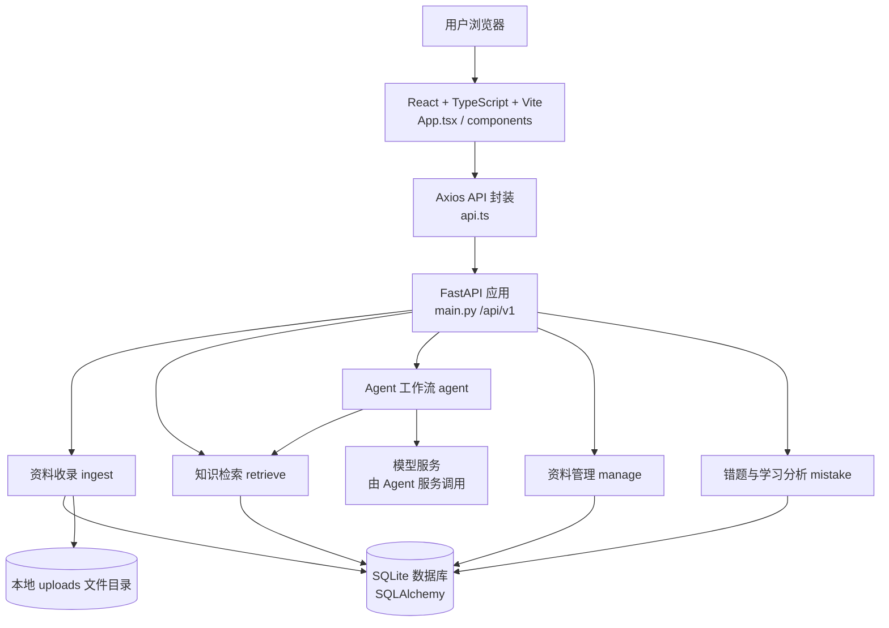
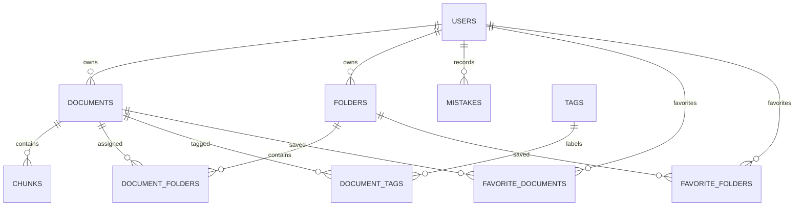
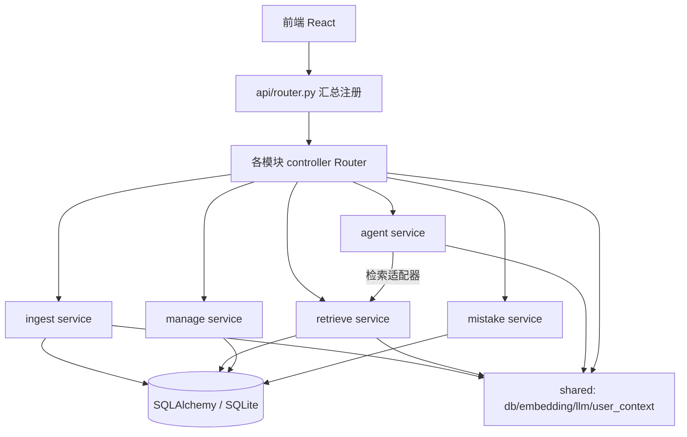
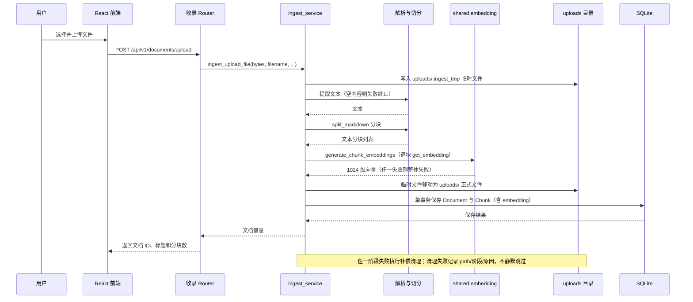
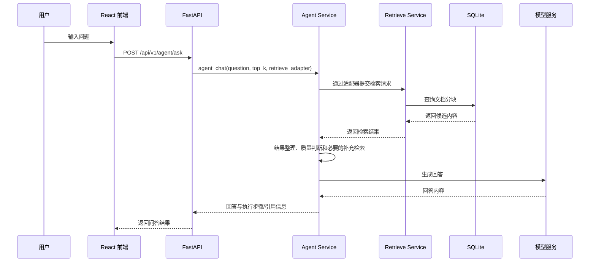
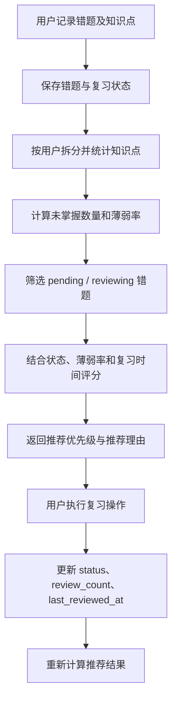

# Personal Knowledge Base — 系统架构与模块设计

> 文档版本：1.1
> 更新日期：2026-11-16
> 文档状态：按当前已实现代码整理（Issue #54 按真实业务边界校对模块、路由与数据流）
> 适用仓库：`epoch-fresh-2026/personal-knowledge-base`
>
> 阅读约定：本文只描述**已实现**的结构；**未实现**能力与**未来设想**统一在第 11 节列出，
> 不将规划内容写作现有能力。产品视角的用户故事、主流程、异常流程与验收标准见
> `docs/user-stories.md`；错题领域的统计与推荐口径见 `docs/mistake-business-rules.md`。

## 1. 项目概述

Personal Knowledge Base 是一个面向个人学习与知识管理的 Web 系统。系统将个人资料收录、知识检索、AI 辅助问答、错题管理、薄弱知识点分析和个性化复习建议整合在同一应用中，形成从知识收集到学习反馈的基本闭环。

系统当前包含两类相互配合的业务：

1. **个人知识管理**：上传文件或收录网页内容，对文档进行分类、标签管理、收藏与公开分享，并通过检索和 Agent 工作流查询个人资料。
2. **学习管理**：记录错题和关联知识点，跟踪复习状态与次数，统计知识点掌握情况，并基于规则生成复习建议。

本文档描述当前代码中已经实现的结构。尚未实现的能力会在“当前边界与后续改进”中单独说明，不将规划功能描述为现有能力。

## 2. 技术架构

| 层次 | 当前技术/实现 | 主要职责 |
|---|---|---|
| 前端 | React、TypeScript、Vite | 页面展示、交互、用户切换、调用后端 API |
| 前端请求层 | Axios，集中封装于 `frontend/src/api.ts` | 统一配置 API 地址和请求方法 |
| 后端 Web 层 | Python、FastAPI | HTTP 路由、参数校验、依赖注入、响应返回 |
| 业务层 | Python Service | 文档处理、检索、Agent 工作流、标签/文件夹管理、错题分析与推荐 |
| 数据访问层 | SQLAlchemy | ORM 模型和数据库读写 |
| 数据库 | SQLite（由 `DATABASE_URL` 配置） | 保存用户、文档、分块、文件夹、标签、收藏和错题等业务数据 |
| 文件存储 | 本地 `backend/uploads/` | 保存上传的原始文件 |
| 文档解析 | pypdf、python-docx、BeautifulSoup、httpx | 解析 PDF/Word 文本、抓取网页文本 |

### 2.1 系统总体架构



说明：前端通过 FastAPI 的 `/api/v1` 接口访问业务能力。后端通过 SQLAlchemy 访问 SQLite；上传文件本体保存在本地目录，文档元数据和文本分块保存在数据库。Agent 工作流通过检索适配器调用检索服务，并由 Agent 服务组织问答步骤。

## 3. 项目目录结构

以下目录树省略 `__pycache__`、`.pytest_cache`、`.venv`、构建产物和其他运行时文件，只保留源代码及主要运行目录。

```text
personal-knowledge-base/
├─ backend/
│  ├─ main.py                     # FastAPI 应用入口
│  ├─ api/
│  │  └─ router.py                # 路由汇总：仅 include 各业务域 Router，无业务实现
│  ├─ shared/                     # 跨模块基础设施
│  │  ├─ db.py                    # SQLAlchemy Engine、Session、Base、get_db、init_db
│  │  ├─ config.py                # 数据库、LLM、Embedding 等公共配置
│  │  ├─ embedding.py             # 唯一的 Embedding 供应商调用实现（get_embedding）
│  │  ├─ llm.py                   # LLM 客户端（chat_completion）
│  │  └─ user_context.py          # 模拟用户上下文依赖 get_current_user（Issue #45）
│  ├─ modules/
│  │  ├─ ingest/                  # 文档收录与解析
│  │  │  ├─ controller/router.py  # 收录 HTTP 路由（upload / url）
│  │  │  ├─ domain/               # 文档、分块、用户、 FavoriteDocument 等模型
│  │  │  ├─ repository/           # 文档持久化
│  │  │  └─ service/              # ingest_service、embedding_service、splitter、reindex
│  │  ├─ retrieve/                # 知识检索
│  │  │  ├─ controller/router.py  # 检索 HTTP 路由（search）
│  │  │  ├─ repository/           # chunk_repo 数据访问
│  │  │  └─ service/              # search 混合检索服务
│  │  ├─ agent/                   # Agent 智能问答工作流
│  │  │  ├─ controller/router.py  # 问答 HTTP 路由（agent/ask）
│  │  │  ├─ service/              # agent_service.py
│  │  │  └─ tools/                # retrieve_tool.py、qa_tool.py
│  │  ├─ manage/                  # 文档/文件夹/标签/收藏和公开管理
│  │  │  ├─ controller/router.py  # 管理 HTTP 路由（文档/文件夹/标签/广场/收藏）
│  │  │  ├─ domain/               # Folder、DocumentFolder、Tag、DocumentTag 等模型
│  │  │  └─ service/              # document_service（含删除生命周期）、folder_service、tag_service
│  │  └─ mistake/                 # 错题与学习管理
│  │     ├─ controller/router.py  # 错题 HTTP 路由
│  │     ├─ domain/models.py      # Mistake、MistakeReviewRecord 唯一正式定义（Issue #53）
│  │     └─ service/              # 知识点统计、复习推荐、学习分析
│  ├─ migrations/                 # 数据库迁移脚本
│  ├─ tests/                      # 自动化测试
│  ├─ uploads/                    # 上传文件存储目录
│  ├─ requirements.txt
│  └─ .env.example
├─ docs/
│  ├─ architecture.md             # 本文：技术架构、模块职责、依赖与数据流
│  ├─ user-stories.md             # 用户故事、主流程、异常流程与验收标准
│  └─ mistake-business-rules.md   # 错题统计与推荐口径
├─ frontend/
│  ├─ src/
│  │  ├─ main.tsx                 # React 启动入口
│  │  ├─ App.tsx                  # 主布局、导航和页面切换
│  │  ├─ api.ts                   # Axios 实例与 API 方法
│  │  ├─ App.css
│  │  ├─ index.css
│  │  ├─ assets/
│  │  └─ components/
│  │     ├─ ChatArea.tsx
│  │     ├─ UploadPanel.tsx
│  │     ├─ FolderView.tsx
│  │     ├─ FavoriteView.tsx
│  │     ├─ MistakeView.tsx
│  │     ├─ KnowledgePointView.tsx
│  │     ├─ ReviewRecommendationView.tsx
│  │     ├─ SquareView.tsx
│  │     └─ UserProfileView.tsx
│  └─ package.json
└─ README.md
```

Issue #54 后，API 路由已按真实业务域拆分到各模块的 `controller/router.py`；`backend/api/router.py` 只负责汇总注册，不再包含业务实现。部分模块仍保留仅含 `.gitkeep` 的预留 `domain`/`repository` 目录（如 retrieve/domain、manage/repository），这是历史占位，不代表存在未实现的空壳服务；本次整理遵循「不为目录整齐而机械分层、不新增无实际职责文件」的原则，未向这些目录填充空文件。

## 4. 后端模块职责

### 4.1 ingest：资料收录

**职责**：接收文件或网页地址，提取可处理的文本，完成切分与向量化，将文档元数据和文本分块在一个数据库事务内保存。

统一入口为 `modules.ingest.service.ingest_service`（Issue #52）：

1. **文件上传**：先把文件写入 `uploads/.ingest_tmp` 临时目录，再解析文本；空内容直接判定失败，不留半成品。
2. **URL 收录**：先做 http/https + hostname 基础校验，抓取网页并用 BeautifulSoup 提取文本，保存用户原始 `source_url`；空内容同样失败终止。
3. 调用 `split_markdown` 对文本分块。
4. 调用 `embedding_service.generate_chunk_embeddings`，其底层是 `shared.embedding.get_embedding`（唯一的 Embedding 供应商实现）；任一 chunk 向量化失败则整体收录失败。
5. 向量成功后，把临时文件移动为 `uploads/` 下的正式文件，再在**单个数据库事务**中创建 `Document` 与 `Chunk` 并持久化。
6. 任一阶段失败均执行补偿清理：临时文件或已落地的正式文件被安全删除，清理失败以日志留痕（路径/阶段/原因），不静默跳过。

图片/视频为**占位实现**：仅保存原文件并生成标记文本，不参与语义检索，未实现 OCR/ASR/图像或视频理解（详见第 11 节）。批量向量化编排位于 ingest，Embedding 供应商调用只在 shared 保留一份（Issue #52 有单一实现回归测试）。

### 4.2 retrieve：知识检索

**职责**：根据用户查询，从已收录的知识内容中检索相关资料；按调用方传入的当前用户上下文限定可见文档范围（本人文档＋他人公开文档，排除他人私有与软删文档，见 Issue #46），不负责身份来源判断（身份由 `get_current_user` 提供）。

主要入口：`GET /api/v1/search`（路由位于 `modules/retrieve/controller/router.py`），调用 `modules.retrieve.service.search.search(db, query, user_id, top_k)`。当前实现为混合检索：余弦语义相似度（复用 `shared.embedding.get_embedding`）+ jieba 关键词命中，按权重合并排序；Embedding 不可用时降级为纯关键词检索。检索统一排除已软删除文档（Issue #47），并按当前用户可见范围过滤关键词与语义检索结果（Issue #46，PR #56）；缺少或非法 `user_id` 时服务层 fail-closed 拒绝查询，不退化为全局检索。

> 历史注记（PR #56 合并前的记录）：本节原写"访问范围过滤按既定约定留待 #46 处理、当前未实现"，系 Issue #54 工程整理时的状态描述。该能力已由 Issue #46 实现并随 PR #56（`849daad`，2026-11-19 合并）完成：关键词检索、语义检索主查询与二次回查、Agent 多轮检索均按当前用户可见范围过滤，统一规则见 `shared/document_visibility.py`。此注记仅保留历史，不代表当前状态。

### 4.3 agent：Agent 智能问答

**职责**：组织多步骤问答流程，协调检索工具和答案生成工具。

主要入口：`POST /api/v1/agent/ask`。API 层创建检索适配器，将查询请求交给 `agent_chat`。Agent 服务通过工具层调用检索和问答能力，避免在 Agent 工作流中直接操作数据库。

当前工作流包含查询处理、多路检索结果整理、去重与排序、检索质量判断、必要时进行一次补充检索、执行步骤记录和答案生成等环节。检索由 API 层提供适配器，Agent 不直接持有数据库 Session。

### 4.4 manage：资料管理

**职责**：管理文档元数据与生命周期、文件夹、标签、公开状态、公共广场和收藏。

主要能力与承载服务：

- `document_service`：文档列表/过滤/元数据修改，以及完整删除生命周期（软删除、恢复、永久删除与孤立文件 write-ahead 补偿清单 `.orphan_cleanup.json`，Issue #47）。删除逻辑于 Issue #54 从 `folder_service` 迁入，使文档规则集中于文档服务。
- `folder_service`：文件夹创建/重命名/删除、文档与文件夹关联、公开文件夹、公共广场与收藏（Issue #48/#49）。
- `tag_service`：标签创建/删除/置顶、文档与标签关联（Issue #51）。

「未删除 且 [所有者本人 或 已公开]」这一可见性口径统一由 `document_service.is_document_visible_to_user` / `visible_document_condition` 提供，供正文读取（#50）与收藏（#49）复用，避免多入口各自实现出不同版本。

HTTP 路由位于 `modules/manage/controller/router.py`，仅做请求/响应适配与错误映射。

### 4.5 mistake：错题与学习管理

**职责**：管理错题、复习状态、知识点统计和个性化复习建议。

包含三类主要能力：

1. **错题管理**：新增、查询、编辑、删除错题，修改复习状态。
2. **薄弱知识点分析**：拆分错题中的知识点字段，按用户统计错题数、复习状态分布、复习次数和薄弱率。当前薄弱率定义为“未掌握错题数 / 关联错题总数”，未掌握包括 `pending` 和 `reviewing`。
3. **个性化复习建议**：筛选当前用户的待复习和复习中错题，根据复习状态、知识点薄弱情况和距上次复习时间计算规则评分，返回优先级及可解释推荐理由。已掌握错题不进入推荐列表。

复习操作复用错题复习接口，更新状态、累计复习次数和最近复习时间。推荐结果当前为动态计算结果，没有单独持久化为复习任务表。

## 5. 前端结构与页面职责

前端使用 `App.tsx` 管理主布局和侧边栏导航，各业务页面由独立 React 组件承担。`api.ts` 创建 Axios 实例并集中封装后端请求。

| 页面组件 | 功能 |
|---|---|
| `ChatArea.tsx` | AI 智能问答 |
| `UploadPanel.tsx` | 文件上传与资料收录 |
| `FolderView.tsx` | 个人资料库和文件夹管理 |
| `FavoriteView.tsx` | 收藏管理 |
| `MistakeView.tsx` | 错题新增、编辑、删除和复习 |
| `KnowledgePointView.tsx` | 薄弱知识点统计和状态分布 |
| `ReviewRecommendationView.tsx` | 推荐任务、评分、理由和复习操作 |
| `SquareView.tsx` | 公共资料浏览 |
| `UserProfileView.tsx` | 用户公开资料页面 |

前端通过 `getCurrentUser()` 读取浏览器 `localStorage` 中的当前演示用户，并在相关请求中传递 `user_id`。当前实现是演示用的用户切换机制，不等同于完整的身份认证和授权系统。

## 6. 核心数据模型

数据库连接由 `backend/shared/db.py` 创建，数据库地址从 `shared.config.DATABASE_URL` 读取。当前开发环境使用 SQLite，默认数据库文件为 `pkb.db`。ORM 基类和 Session 由 SQLAlchemy 管理。

已使用的主要业务表包括：

| 数据表 | 用途 |
|---|---|
| `users` | 用户基本信息 |
| `documents` | 文档元数据、来源、公开状态和所有者 |
| `chunks` | 文档切分后的文本片段 |
| `folders` | 用户文件夹 |
| `document_folders` | 文档与文件夹关联 |
| `tags` | 文档标签 |
| `document_tags` | 文档与标签关联 |
| `favorite_documents` | 用户收藏的文档 |
| `favorite_folders` | 用户收藏的文件夹 |
| `mistakes` | 错题题目、知识点、复习状态、累计次数与最近复习时间 |
| `mistake_review_records` | 每次复习生成的独立记录（Issue #53，ORM 级联随错题删除） |

主要关系可概括为：



`Mistake` 当前包含题目、正确答案、错误答案、错误原因、`knowledge_points`、`status`、`review_count`、`last_reviewed_at` 和创建/更新时间等字段。复习状态使用 `pending`、`reviewing`、`mastered`。

收录时由 `ingest_service` 在入库前完成向量生成：`generate_chunk_embeddings` 通过 `shared.embedding.get_embedding` 得到 1024 维向量并写入 `Chunk.embedding`，再与 `Document` 在同一事务内存库（Issue #52）。因此当前流程已落地「向量生成 + 基于向量的语义检索」，但不使用独立向量数据库或 pgvector（详见第 11 节）。历史遗留的 `embedding IS NULL` 分块由 `backfill_embeddings.py` / `reindex_service` 补全。

`Mistake` 与 `MistakeReviewRecord` 的唯一正式定义在 `modules/mistake/domain/models.py`（Issue #53）；`ingest.domain.models` 仅保留兼容重导出，两者是同一 ORM 类对象，不产生第二套表映射。错题统计与推荐的详细口径见 `docs/mistake-business-rules.md`。

## 7. 模块依赖与边界



依赖原则（Issue #54 按真实边界明确）：

- **shared**：数据库会话与配置、LLM 客户端、唯一的 Embedding 供应商实现、模拟用户上下文，均为跨模块基础设施。
- **ingest**：文件/URL 收录、解析、切分、批量向量化编排与 Document/Chunk 持久化；供应商 Embedding 调用复用 shared，不重复实现。
- **retrieve**：关键词/语义/混合检索；按调用方传入的当前用户范围检索，不判断身份来源；访问范围过滤已由 Issue #46（PR #56）实现，规则复用 `shared/document_visibility.py`。
- **agent**：问题改写、检索工具调用、补充检索判断与答案组织；不直接访问数据库，检索访问范围由 API 层适配器传入。
- **manage**：文档（含删除生命周期）、文件夹、标签、收藏、公开资料；可见性规则统一在 document_service。
- **mistake**：错题、复习记录、知识点统计、复习推荐与学习分析，模型归属本模块。
- **api**：仅 HTTP 请求/响应适配、参数校验、依赖注入与路由汇总，不承载复杂业务规则。

路由分层现状：Issue #54 后，业务域 Router 已分散到各模块 `controller/router.py`，`api/router.py` 只做汇总注册。本次整理不新增无实际职责的空 controller/repository/service 文件；保留的 `.gitkeep` 目录仅为历史占位。

## 8. 核心业务数据流

### 8.1 文件收录流程（Issue #52 统一流程）



### 8.2 Agent 问答流程



### 8.3 错题分析与复习流程



## 9. 主要 API 入口

统一 API 前缀为 `/api/v1`。当前入口包括：

| 路径 | 方法 | 作用 |
|---|---|---|
| `/health` | GET | 服务健康检查（不带 `/api/v1` 前缀） |
| `/api/v1/documents/upload` | POST | 上传文件并收录 |
| `/api/v1/documents/url` | POST | 收录网页 URL |
| `/api/v1/search` | GET | 知识检索 |
| `/api/v1/agent/ask` | POST | Agent 智能问答 |
| `/api/v1/tags` | GET/POST | 标签查询与创建 |
| `/api/v1/folders` | GET/POST | 文件夹查询与创建 |
| `/api/v1/mistakes` | GET/POST | 错题查询与新增 |
| `/api/v1/mistakes/{mistake_id}` | PUT/DELETE | 编辑与删除错题 |
| `/api/v1/mistakes/{mistake_id}/review` | POST | 完成一次复习并更新记录 |
| `/api/v1/mistakes/knowledge-points` | GET | 薄弱知识点统计 |
| `/api/v1/mistakes/recommendations` | GET | 个性化复习建议 |

完整接口清单以运行时的 `/docs`（OpenAPI）为准。按域划分的路由文件：收录见 `modules/ingest/controller/router.py`，检索见 `modules/retrieve/controller/router.py`，问答见 `modules/agent/controller/router.py`，文档/文件夹/标签/广场/收藏见 `modules/manage/controller/router.py`，错题见 `modules/mistake/controller/router.py`；`api/router.py` 仅汇总注册。其余文档生命周期接口包括：`/documents/{id}/content`（GET，正文，#50 可见性口径）、`/documents/{id}`（DELETE，软删除）、`/documents/{id}/restore`（POST，恢复）、`/documents/{id}/permanent`（DELETE，彻底删除）、`/square`（GET，公共广场）、`/favorites`（GET，收藏列表）。

## 10. 本地运行方式

以下为项目当前采用的开发方式，具体端口以启动命令输出为准。

### 后端

```cmd
cd backend
.venv\Scripts\activate
python -m uvicorn main:app --reload
```

后端默认开发地址：`http://127.0.0.1:8000`。Swagger 文档：`http://127.0.0.1:8000/docs`。

### 前端

```cmd
cd frontend
npm install
npm run dev
```

Vite 会在终端中显示前端开发地址，通常为 `http://localhost:5173`。

### 测试与构建

在项目根目录运行后端测试：

```cmd
backend\.venv\Scripts\python.exe -m pytest -q backend
```

在 `frontend` 目录运行前端生产构建：

```cmd
npm run build
```

## 11. 已实现 / 未实现 / 未来设想

为便于区分现状与规划，按三类列出关键能力边界。

### 11.1 已实现（代码与测试可验证）

- **混合检索**：收录时通过 shared Embedding 生成向量并入库（Issue #52），检索融合余弦语义相似度与 jieba 关键词命中，Embedding 不可用时降级为关键词检索；排除已软删除文档。
- **检索访问范围过滤（Issue #46，PR #56）**：关键词检索、语义检索主查与回查、Agent 多轮检索、文档筛选与正文读取统一按当前用户可见范围过滤（本人文档＋他人公开文档，排除他人私有与软删文档）；规则单一定义在 `shared/document_visibility.py`，服务层采用 fail-closed，缺少或非法 `user_id` 时拒绝查询而不退化为全局检索。
- **文档删除生命周期**：软删除 / 恢复 / 永久删除与孤立文件 write-ahead 补偿清单（Issue #47），集中在 `document_service`。
- **模拟多用户数据隔离**：前端 `localStorage` 传 `user_id`，后端 `get_current_user` 统一校验（Issue #45）；正文（#50）、收藏（#49）、标签（#51）、文件夹（#48）、错题（#53）按已确认规则隔离。
- **错题与学习分析**：错题/复习记录、知识点统计、趋势（UTC 口径）与规则化复习推荐，口径见 `docs/mistake-business-rules.md`（Issue #53）。
- **按业务域拆分的路由**：各模块 controller 持有 Router，`api/router.py` 仅汇总注册（Issue #54）。

### 11.2 未实现（明确不作为现有能力描述）

- ~~**检索访问范围过滤**（原列为未实现，PR #56 合并前的记录）~~：已由 Issue #46 / PR #56（`849daad`）完成，移至 §11.1「已实现」，此处保留原条目仅作历史追溯，不代表当前状态。
- **认证与授权**：`user_id` 仅为演示用模拟身份，无注册/登录/Token/Session，不构成安全边界，客户端可伪造。
- **独立向量数据库 / pgvector**：向量存于 SQLite 的 `Chunk.embedding` 文本字段，在应用内计算相似度，未使用向量数据库。
- **图片与视频理解**：仅保存原文件并生成占位文本，未实现 OCR、图像理解或视频 ASR。
- **复习任务持久化**：推荐结果为动态计算，无独立复习任务表。

### 11.3 未来设想（未排期，仅记录方向）

- 基于现有错题与复习记录扩展学习趋势、复习频次、知识点掌握变化的可视化。
- 生产部署前收窄 CORS、完善密钥管理与服务端授权（当前 `main.py` CORS 允许所有来源，属开发配置）。

## 12. 总结

系统当前已经形成“资料收录 → 知识检索 → Agent 问答 → 错题记录 → 薄弱知识点分析 → 个性化复习建议”的主要业务闭环。Issue #54 之后，模块职责、路由分层、删除生命周期归属与文档描述进一步对齐真实代码：api 层只做适配与汇总，业务规则下沉到对应 service，跨模块共用能力集中在 shared，并区分已实现/未实现/未来设想。检索范围规则已由 Issue #46（PR #56）落地，统一在 `shared/document_visibility.py`；后续建设按第 11.3 节方向推进。

> 历史注记（PR #56 合并前的记录）：本总结原结尾写"具体检索范围规则等需求明确后再行处理"，系 Issue #54 时期状态。该规则已明确为"本人（含私有）＋他人公开、排除他人私有与软删"并由 PR #56 实现合并，此处不再作为待办。
